# AI-Powered Human Presence and Activity Detection Using Wi-Fi Signals

**CSI SPACE MONITOR · PBEL Group A18 · DES Pune University, Pune · 2026–27**

A student research prototype for nonvisual sensing in confidential research laboratories and privacy-sensitive technical workspaces. Two classic ESP32-D0WD-V3 boards acquire a controlled Wi-Fi link; a laptop uses engineered CSI and RSSI features to predict `NO_PRESENCE`, `PERSON_PRESENT` or `PERSON_MOVING`.

**Main measured result: 67.86% held-out window accuracy (114/168), with macro F1 0.6625.** This is a recorded laboratory experiment. The prototype is not established as a dependable security detector, an identity recognizer or a room-independent sensing system.

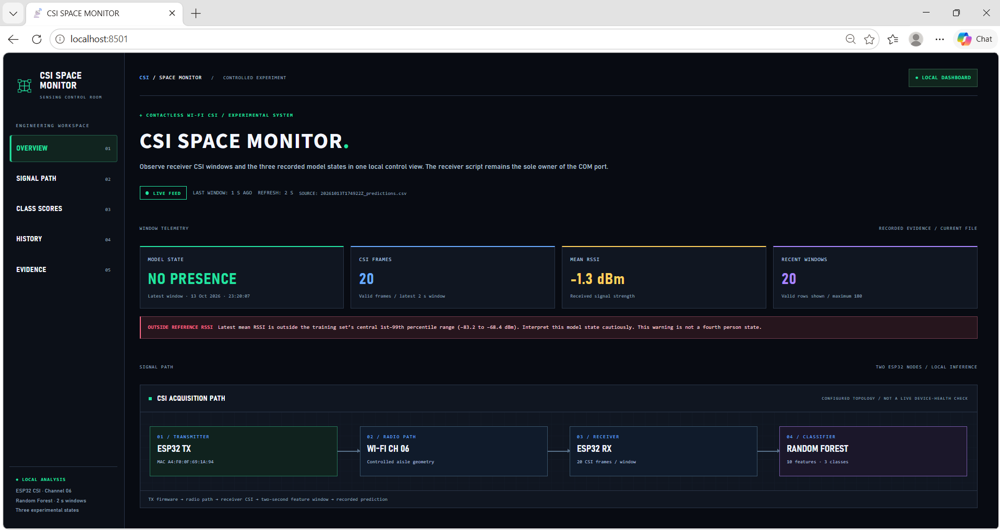

*Original dashboard evidence. The −1.3 dBm RSSI value is outside the training reference range; the red warning is retained and its cause remains unresolved. A displayed label is a model prediction, not independently verified ground truth.*

**ESP-IDF v5.5.5 · ESP-NOW · Python · NumPy · scikit-learn Random Forest · Streamlit**

[Architecture](#system-architecture) · [Dataset](#experimental-dataset) · [Evaluation](#model-evaluation) · [Colab](#google-colab-evaluation) · [Run locally](#run-the-live-system-on-windows) · [Team](#project-team--contributors) · [References](#references-and-acknowledgments)

## System Architecture

The implemented path is **ESP32 transmitter → radio propagation → ESP32 CSI receiver → USB serial → Python preprocessing → two-second feature windows → Random Forest → timestamped prediction CSV → CSI SPACE MONITOR**.

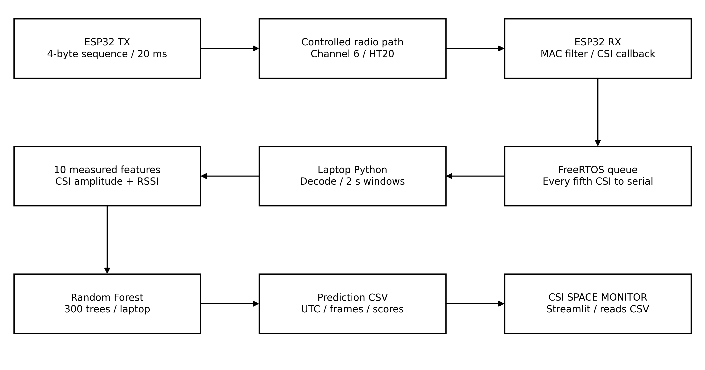

[Editable architecture SVG](docs/assets/architecture/01_implemented_architecture.svg)

| Component | Actual implementation |
|---|---|
| Transmitter | `pbel_csi_tx/main/tx_main.c`, selected by component CMake; ESP-NOW broadcast of a four-byte unsigned sequence |
| Receiver | `pbel_csi_rx/main/main.c`; transmitter-MAC filter, CSI callback, 16-entry FreeRTOS queue and separate serial task |
| Radio | Channel 6, HT20, MCS0 with long guard interval; nominal 20 ms scheduling and 50 packet opportunities/s |
| Recorded link checks | Approximately 249–250 receiver packets and CSI callbacks per five seconds after the HT PHY correction |
| Saved serial stream | Every fifth eligible CSI callback; 115200 baud; pilot mean 9.82 saved rows/s |
| Laptop | CSI decoding, ten features, 300-tree Random Forest, UTC prediction CSV and local Streamlit visualization |

The **four-byte transmitted application payload** is distinct from the **128-byte CSI buffer estimated at the receiver**. CSI is not sent as the application payload. The 6.5 Mb/s nominal PHY rate is also distinct from payload throughput, serial baud rate and saved CSV row rate.

Recorded CSI has 128 signed bytes (64 imaginary/real pairs). The first four invalid bytes are excluded, leaving 62 retained complex positions. Magnitudes use `hypot` on the signed pairs. These positions are not all independent usable data subcarriers. The sender's 48-bit MAC is separate metadata. The current receiver enables LLTF CSI and disables HT-LTF/STBC-HT-LTF capture; the evaluated features use magnitude and RSSI, without calibrated phase or FFT descriptors.

Both actual boards identify as **ESP32-D0WD-V3 revision 3.1**, target `esp32`. The proposal initially specified ESP32-S3, but the recorded implementation used classic ESP32 boards. Firmware is native ESP-IDF C; no Arduino replacement is supplied. [Hardware setup](HARDWARE_SETUP.md) · [Architecture details](ARCHITECTURE.md)

## Experimental Dataset

The expanded **LAB_B dataset was recorded on 9 October 2026**. Chronologically sorted CSV files reconstruct fifteen rounds, each containing one recording of every class.

| Class | Sessions | Raw CSI rows |
|---|---:|---:|
| `NO_PRESENCE` | 15 | 8,941 |
| `PERSON_PRESENT` | 15 | 8,916 |
| `PERSON_MOVING` | 15 | 8,923 |
| **Total** | **45** | **26,780** |

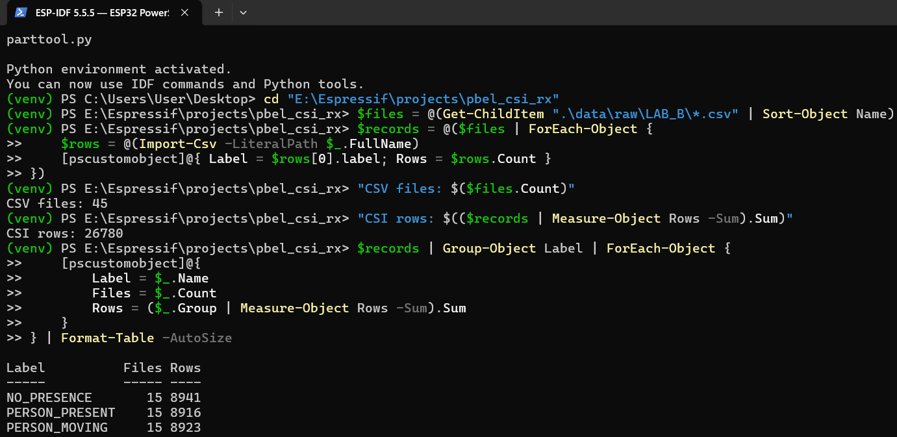

Each session supplies **28 non-overlapping two-second windows**, over receiver uptime [20 s, 76 s), with at least ten valid frames per window. Observed LAB_B window counts were 17–21 frames.

| Partition | Sessions | Windows | Purpose |
|---|---:|---:|---|
| Rounds 1–13 | 39 | 1,092 | Thirteen leave-one-round-out validation folds, then final model fitting |
| Rounds 14–15 | 6 | 168 | Separate fixed held-out test; excluded from baseline fitting and validation |
| All rounds | 45 | 1,260 | 45 × 28 evaluated windows |

The earlier **6 October pilot** has 15 sessions and 11,041 raw rows; a separate preparation-period trim retained 8,461 rows. It was not merged into LAB_B to claim sixty independent sessions. Adjacent windows share recording conditions, and different files do not establish different people or rooms. Raw recordings remain under team-controlled access and are excluded from this repository. [Dataset description](DATASET_DESCRIPTION.md)

## Model Evaluation

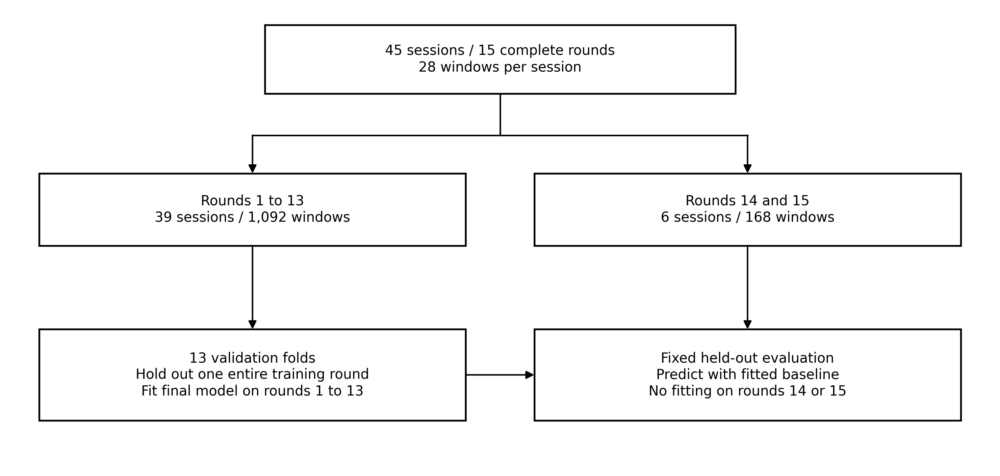

[Editable split diagram SVG](docs/assets/architecture/02_round_separated_evaluation.svg)

| Evaluation stage | Accuracy | Interpretation |
|---|---:|---|
| Training-set fit | 97.25% | Optimistic accuracy on the 1,092 windows used for final fitting |
| Leave-one-round-out validation | 78.39% | Predict each development round using a model fitted on the other twelve |
| **Held-out test** | **67.86%** | **114 correct of 168 windows from rounds 14–15** |

Validation macro F1 is **0.7815**; held-out macro F1 is **0.6625**. The report-preparation audit reran the executed notebook's evaluation and matched every supplied `metrics.json` value. The unmodified saved model also reproduced the held-out confusion matrix. This was a computational reproduction of the recorded experiment, not another hardware collection.

### Original Confusion Matrices

**Validation:** whole-round folds within rounds 1–13. The matrix summarizes 1,092 out-of-fold predictions and does not use the final test rounds.

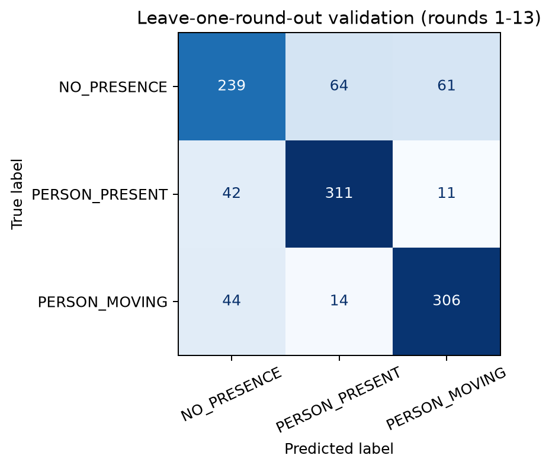

**Held-out test:** the fitted baseline predicts only rounds 14–15. Rows are actual classes, columns are predictions, in the same three-class order.

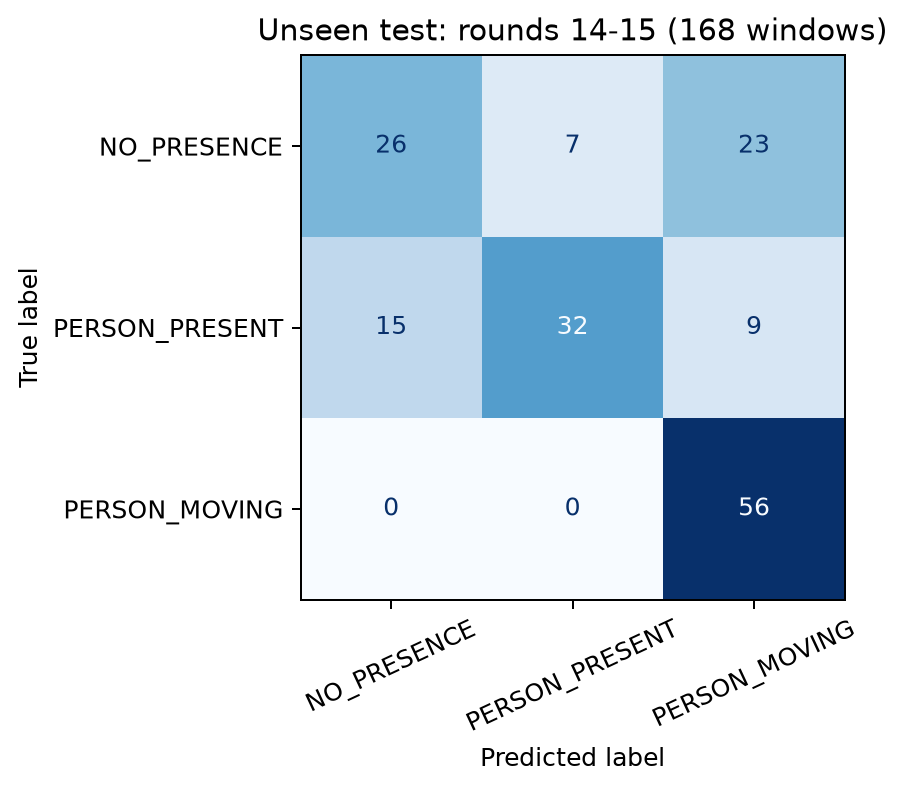

| Actual / Predicted | `NO_PRESENCE` | `PERSON_PRESENT` | `PERSON_MOVING` |
|---|---:|---:|---:|
| `NO_PRESENCE` | 26 | 7 | 23 |
| `PERSON_PRESENT` | 15 | 32 | 9 |
| `PERSON_MOVING` | 0 | 0 | 56 |

Empty-room recall was 46.4% and stationary-presence recall 57.1%. Movement recall was 100% on these 56 movement windows, but precision was only 63.6% because 32 nonmovement windows were also predicted as movement. This does not demonstrate perfect movement detection in general conditions. Five of six held-out session-majority decisions matched the recording label; the stationary session in round 15 was predicted as empty. That small secondary aggregation does not replace window-level testing.

<details>
<summary><strong>Original PowerShell training and held-out output</strong></summary>

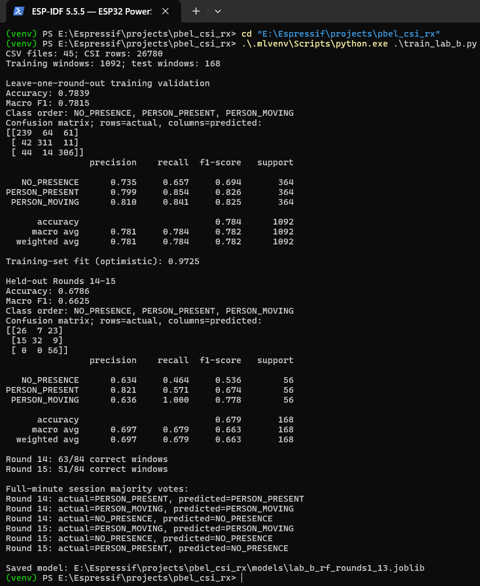

The high training fit, grouped validation and fixed test are separate results. The final demonstration must not present 97.25% as deployment accuracy.

</details>

### Ten Implemented Features

Features 1–8 summarize CSI amplitudes; features 9–10 summarize RSSI in dBm. Standard deviations use NumPy's population definition (`ddof=0`).

| Feature | Actual calculation in each two-second window |
|---|---|
| `amp_mean` | Mean of amplitudes pooled across frames and retained CSI positions |
| `amp_std` | Standard deviation of those pooled amplitudes, across time and positions |
| `amp_p10` | 10th percentile of the pooled amplitudes; constant zero in training and zero model importance |
| `amp_p90` | 90th percentile of the pooled amplitudes |
| `subcarrier_profile_std` | Standard deviation across positions after averaging each position over time |
| `temporal_spread` | Mean across positions of each position's standard deviation over time |
| `change_mean` | Mean absolute amplitude difference between consecutive saved frames, pooled over positions |
| `change_p90` | 90th percentile of those absolute consecutive-frame differences |
| `rssi_mean` | Mean received RSSI over the window's frames |
| `rssi_std` | Standard deviation of received RSSI over those frames |

The saved forest uses `n_estimators=300`, `min_samples_leaf=3`, `class_weight="balanced"`, `random_state=42` and `n_jobs=-1`. It learns nonlinear relationships in a tabular representation. Feature importance does not imply that every input contributes equally or causally. [Detailed model evaluation](MODEL_EVALUATION.md) · [Original metrics](results/baseline/metrics.json)

### Variation Across Recording Rounds

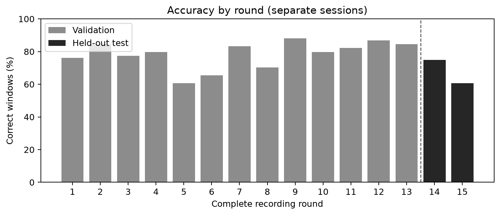

Development out-of-fold round accuracy ranges from 60.71% to 88.10%; test rounds 14 and 15 achieved 75.00% and 60.71%. This shows sensitivity to recording conditions under the nominal setup, rather than one universal performance value.

<details>
<summary><strong>Detailed analysis: session overlap, correlation and feature importance</strong></summary>

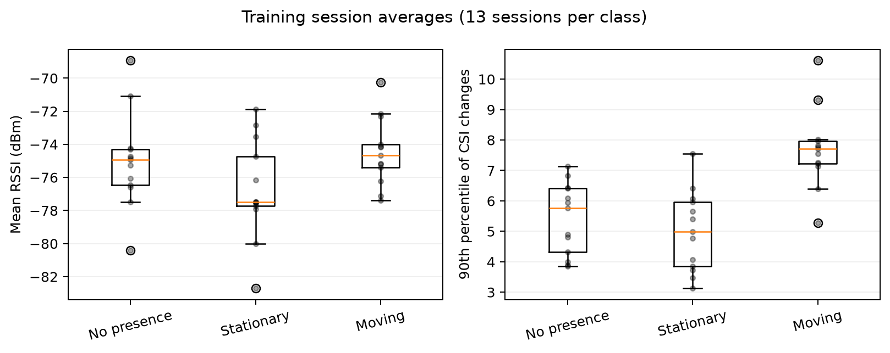

Session-level RSSI distributions overlap between classes; movement tends to produce larger consecutive-frame changes, with overlap still present. No perfect one-feature threshold is established.

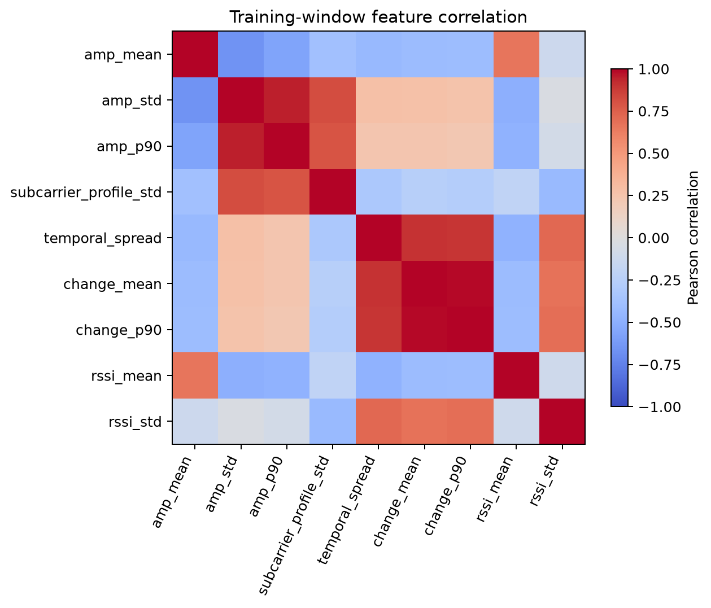

Several engineered descriptors are correlated. The constant `amp_p10` is excluded from this correlation matrix only, while remaining in the saved ten-input model schema.

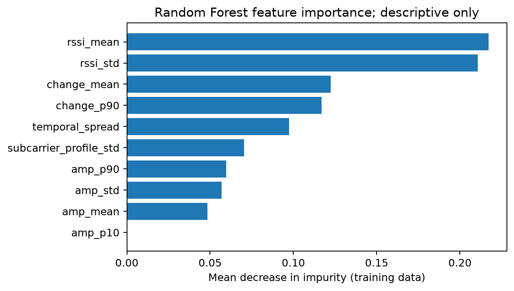

RSSI mean and standard deviation contribute approximately 0.2173 and 0.2106 of impurity importance (42.79% together). These descriptive statistics motivate checking link-strength dependence; they do not prove a causal hardware limitation.

The separately executed **exploratory CSI-only ablation** achieved 62.82% validation and **61.90% held-out accuracy**, with held-out macro F1 0.6061. It used the same fixed split and forest parameters, removing the final two RSSI inputs. These test rounds had already been inspected; the ablation did not select or alter the baseline and is not a new untouched test. [Ablation result](results/exploratory/csi_only_ablation.json)

</details>

## Google Colab Evaluation

**[Open A18 Machine Learning - Evaluation.ipynb in Google Colab](https://colab.research.google.com/drive/1jWTIgqFJRn8l9jVMbjPOYYhrzSJJE172?usp=sharing)**

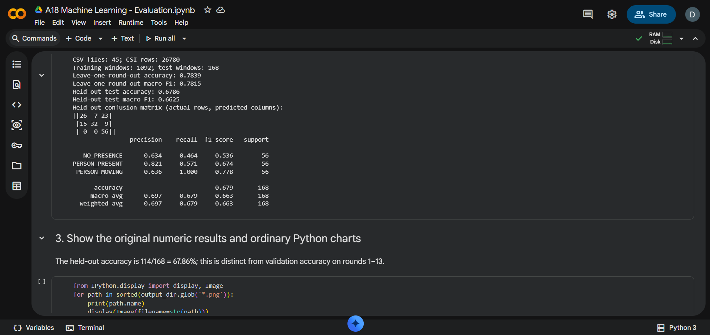

The notebook loads and validates the recorded archive, constructs features, trains the forest, performs grouped validation and held-out testing, generates confusion matrices and the six plots, and exports metrics. Its results match the local numerical output. S04 shows the numerical output before its lower plotting cell was executed; the later fetched notebook contains executed figure/export outputs.

Drive permission metadata checked on 14 October 2026 reports **anyone with the link has Reader access**, with file discovery disabled. Sharing settings were not changed. Colab may require a Google account to run code; access to the team-controlled data archive remains separate.

The [repository notebook](notebooks/A18_Machine_Learning_Evaluation.ipynb) retains the verified source with outputs cleared for a clean publication copy. Upload it into Colab, run its installation cell, and provide the original `LAB_B_rounds1_15.zip` when prompted. The included CLI module performs the same notebook-derived evaluation. See [reproduction instructions](#reproduce-the-recorded-evaluation).

## Run the Live System on Windows

Power the transmitter and connect the receiver. The recorded assignments were TX COM3 / CH9102 and RX COM4 / CP2102; confirm actual ports on the current laptop. Close other serial monitors before inference.

For an existing working environment, open **PowerShell 1 in `pbel_csi_rx`**:

```powershell
.\.mlvenv\Scripts\python.exe .\live_csi.py --port COM4
```

Open **PowerShell 2 in the same receiver folder**:

```powershell
.\.mlvenv\Scripts\python.exe -m streamlit run .\dashboard.py --server.port 8501
```

Open **http://localhost:8501**. This is a local interface; no hosted public dashboard is claimed.

The live process owns serial and writes prediction CSV files. Streamlit reads the latest CSV and refreshes every two seconds; it does not compete for COM4. The interface contains **Overview, Signal Path, Class Scores, History and Evidence**. The Signal Path represents configured modules, not a live physical-health test. RF class scores are uncalibrated outputs. The current source uses a synchronous acquisition/inference loop; no custom Python ML worker thread is claimed. Firmware queueing, separate host processes and scikit-learn CPU parallelism are distinct forms of concurrency.

For a **fresh host**, from the repository root:

```powershell
python -m venv .\pbel_csi_rx\.mlvenv
.\pbel_csi_rx\.mlvenv\Scripts\python.exe -m pip install -r .\requirements.txt
cd .\pbel_csi_rx
```

Then use the two commands above. The exact archived Streamlit version was not available; its requirement range supports the fragment API and is not a claim of the original environment lock. Existing working installations need no reinstall. [Dashboard guide](DASHBOARD_GUIDE.md)

### Live Prediction Evidence

<details>
<summary><strong>Original PowerShell live prediction capture</strong></summary>

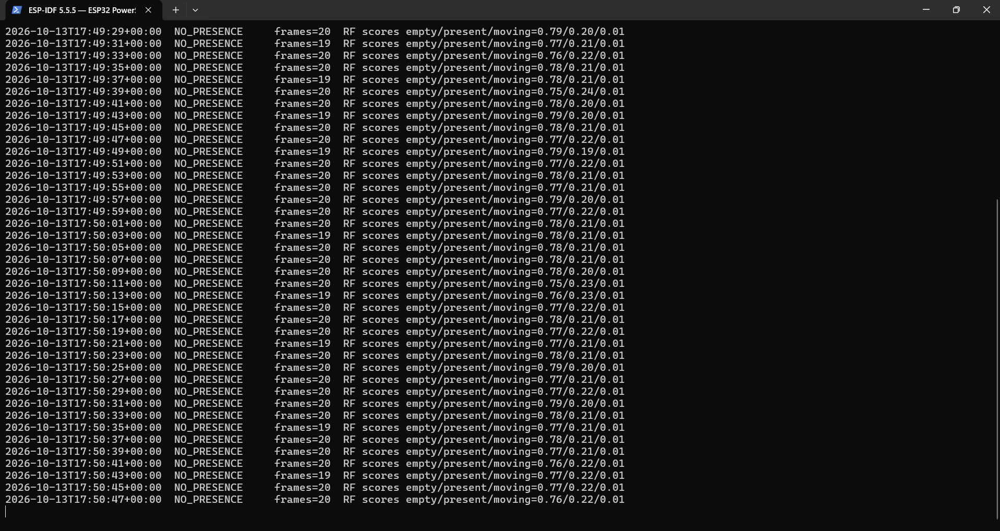

One record matches the dashboard: `2026-10-13T17:50:07+00:00` is 23:20:07 IST, and both screens show `NO_PRESENCE` with 20 frames. Receiver timestamps are microsecond uptime; laptop prediction times are UTC. All visible labels in this terminal capture are `NO_PRESENCE`, so it does not prove correct transitions between all three classes.

</details>

## Reproduce the Recorded Evaluation

Use a separate analysis environment and `requirements-evaluation.txt`. The checked report-preparation rerun used Python 3.12.14, NumPy 2.3.5, pandas 2.2.3, scikit-learn 1.8.0, joblib 1.5.3, SciPy 1.17.0 and Matplotlib 3.10.8. Colab used different pinned versions, disclosed in the original report; its numerical baseline was reproduced exactly.

Place an unaltered copy of the team-controlled archive in `pbel_csi_rx/data/`, then run from the repository root:

```powershell
python .\analysis\lab_b_evaluation.py .\pbel_csi_rx\data\LAB_B_rounds1_15.zip --out .\results\reproduced
python .\analysis\csi_only_ablation.py .\pbel_csi_rx\data\LAB_B_rounds1_15.zip --out .\results\exploratory_reproduced.json
```

These analysis commands do not overwrite the demonstrated saved model. `train_lab_b.py` writes a model; use a separate evaluation copy if rerunning training. No new training or physical serial/firmware execution was performed merely to publish this repository.

## Source Provenance and Experimental Evidence

The firmware, Python modules, sdkconfig snapshots and trusted original model are copied unchanged from the verified source distribution. The dashboard was supplied as the current separately saved version because the older receiver ZIP predated it. The TX's 44-byte alternative `main.c` is retained but inactive; CMake selects `tx_main.c`.

`SOURCE_MANIFEST.csv` records each published file's SHA-256, Git blob SHA, size and source provenance. Evaluation PNGs have one canonical location in `docs/assets/evaluation/`; metrics remain in `results/baseline/`. The source-only notebook retains the prepared source. Original screenshot and diagram pixels are preserved, including warnings.

<details>
<summary><strong>Original CSI metadata screenshot</strong></summary>

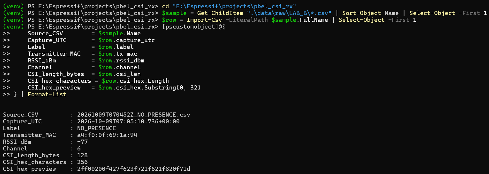

This documents format and receive metadata. It does not turn a row into an independent experiment or place the MAC inside the CSI byte buffer.

</details>

The repository excludes raw recordings, virtual environments, build trees, credentials, machine-specific editor settings, academic signatures/forms, final-report duplicates and large historical ZIPs. Device MAC filters remain necessary for the demonstrated hardware; the repository is initially private. No software license was chosen on the team's behalf. [Publication record](docs/verification/PUBLICATION_SCOPE.md) · [Third-party notices](THIRD_PARTY_NOTICES.md)

## Limitations and Future Work

- **RSSI anomaly:** the recorded −1.3 dBm live value lies outside the training-window reference of approximately −83.2 to −68.4 dBm. The matching latest raw/CSV stream was unavailable; the cause was not established or corrected.
- **Stationary versus empty:** the test matrix shows weaker recall for both classes. Movement can be easier to observe, yet perfect recall on one test does not imply general reliability.
- **Acquisition:** LLTF capture, one link and every-fifth-frame logging restrict the observed signal information. The individual effects on accuracy were not isolated, and no better-board comparison was performed.
- **Diversity and generalization:** forty-five sessions are not evidence of broad participant, room or placement coverage. Window counts cannot substitute for independent experimental conditions.
- **Future measurements:** resolve the signal anomaly with synchronized raw lines and predictions; conduct labelled three-state live trials and prospective person/room/placement holdouts; test the proposed 1 m / 2 m / 3 m comparison, loss and latency. These remain future work.

## Project Team & Contributors

| Team Member | GitHub Profile | Affiliation |
|---|---|---|
| Deven Gaikwad | [@DevenGaikwad](https://github.com/DevenGaikwad) | PBEL Group A18 |
| Anjor Giri | [@anjor022](https://github.com/anjor022) | PBEL Group A18 |
| Nidhi Kanoujia | [@nidhikanoujia-dev](https://github.com/nidhikanoujia-dev) | PBEL Group A18 |

**Shared institution:** DES Pune University, Pune, Department of Electronics and Communication Engineering. **Academic year:** 2026–27. **Mentor:** Mr. Abhijeet Karve. **Reviewer:** Dr. Vaishali Kamble.

All three students are recognized as Group A18 project-team members. No unverified individual responsibilities or development commits are assigned. [CONTRIBUTORS.md](CONTRIBUTORS.md) describes genuine future contribution and review. Repository membership, collaboration access and GitHub's automatic commit-based Contributors statistics are separate concepts; invitations do not establish acceptance or historical code authorship.

This student project is not an officially supported university product.

## References and Acknowledgments

The six research works from the approved report retain reference identities **[3]–[8]**. [Full authors, publication details and verified links](docs/references/REFERENCES.md) are provided separately from project contributors. They cover CSI behaviour surveys, Wi-CaL, room occupancy, location-independent feature fusion, feature-driven recognition and practical ML sensing limitations. No paper's accuracy is substituted for A18 performance.

Official implementation references: [Espressif ESP-CSI](https://github.com/espressif/esp-csi) and [ESP-IDF v5.5.5 ESP32 CSI documentation](https://docs.espressif.com/projects/esp-idf/en/v5.5.5/esp32/api-guides/wifi.html#wi-fi-channel-state-information). [RuView](https://github.com/ruvnet/RuView) is acknowledged only as external architectural inspiration; no affiliation, source replication or benchmark superiority is claimed. Teammate repositories are identity references only and are not CSI implementation sources.
